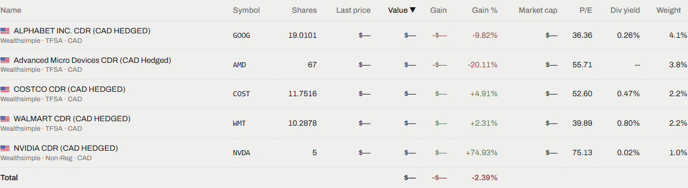

# Wealth Sleuth

**A private, local-first portfolio analytics dashboard for understanding how a portfolio is actually performing.**

Wealth Sleuth imports transaction exports from multiple brokerages, normalizes them into a single SQLite model, calculates holdings and performance, enriches securities with market data, and presents the results in a focused React dashboard.



> The preview uses popular example securities and intentionally redacts exact dollar amounts. It is not a representation of any person's portfolio.

## Why this project exists

Brokerage portals are good at showing account balances, but less good at answering questions such as:

- What is my true position after transfers, splits, distributions, and spinoffs?
- Which positions have generated the strongest realized or unrealized returns?
- How are my holdings allocated across sectors, countries, and accounts?
- What is the difference between portfolio performance and the effect of deposits and withdrawals?
- Can I inspect a security without repeatedly querying an external data source?

Wealth Sleuth treats transaction history as the source of truth and builds the current portfolio from it. This makes the application useful as a personal tool while also demonstrating practical data engineering, financial-domain modeling, API design, caching, and frontend product development.

## Highlights

- **Multi-brokerage ingestion** for Wealthsimple CSV, Qtrade HTML-table `.xls`, and Disnat Excel exports.
- **Normalized transaction ledger** with deduplication and file-change detection.
- **Materialized holdings** rebuilt from transactions, including buys, sells, transfers, corporate actions, stock splits, and cost-basis reallocations for spinoffs.
- **Performance analytics** using time-weighted return (TWR), XIRR, daily portfolio history, cash-flow treatment, and account/security slices.
- **Live security enrichment** through yfinance with cached company details, market cap, P/E, dividend yield, sector, industry, country, and price history.
- **Live price propagation**: background price refreshes update the database and notify the UI so current price, value, gain, and related metrics refresh without a manual reload.
- **Interactive holdings table** with sorting, account/brokerage filters, allocation filters, country flags, and expandable company cards.
- **Inline company research** with fundamentals, 52-week range, description, and selectable price-history windows.
- **Records section** showing top and worst realized/unrealized performers, consolidated across repeated buys.
- **TFSA contribution-room view** with configurable birth year and CAD conversion for USD contributions.
- **Local-first privacy model**: imported transaction documents, SQLite data, and holdings notes are ignored by Git and stay on the user's machine.

## Architecture

```text
Brokerage exports
        │
        ▼
consolidate.py ──► SQLite (portfolio.db)
        │                 │
        ▼                 ├── refresh_holdings.py
 holdings.md              ├── price_history / FX history
                          └── security fundamentals
                                │
             ┌──────────────────┴──────────────────┐
             ▼                                     ▼
       FastAPI backend                       React + TypeScript UI
             │                                     │
             ├── portfolio endpoints              ├── holdings table
             ├── valuation / returns              ├── charts
             ├── records / TFSA                   ├── company cards
             └── background price refresh          └── query/cache refresh
```

### Backend

- Python 3.11+ recommended
- FastAPI and Uvicorn
- SQLite with WAL mode and foreign-key enforcement
- Pandas/openpyxl/xlrd/lxml for document parsing
- yfinance for market data
- Thread-safe in-memory caching for expensive valuation and security queries

### Frontend

- React 19 + TypeScript
- Vite
- TanStack Query for server-state management and refresh behavior
- Tailwind CSS
- Recharts for portfolio and security charts
- Local SVG country flags and Lucide icons

## Quick start on Windows

The repository includes a Windows launcher that starts both services.

### 1. Install Python dependencies

```powershell
python -m venv venv
venv\Scripts\Activate.ps1
python -m pip install -r requirements.txt
```

### 2. Install frontend dependencies

```powershell
cd web
npm install
cd ..
```

### 3. Add transaction exports

Place exports in the expected brokerage/account folders:

```text
transaction documents/
├── wealthsimple/
│   ├── tfsa/
│   └── non reg/
├── qtrade/
│   └── non reg/
└── disnat/
    ├── tfsa/
    └── non reg/
```

These folders are intentionally ignored by Git. Use your own exports; do not commit personal financial data.

### 4. Launch the app

```powershell
launch.bat
```

The launcher starts:

- API: <http://127.0.0.1:8000>
- Web app: <http://127.0.0.1:5173>

On startup the backend initializes the schema, detects changed exports, consolidates new transactions, refreshes holdings, pre-warms valuation caches, fetches missing historical prices, and starts the live-price loop.

## Useful commands

Run these from the repository root:

```powershell
# Consolidate transaction exports and rebuild holdings
venv\Scripts\python.exe consolidate.py

# Also fetch missing security fundamentals during consolidation
venv\Scripts\python.exe consolidate.py --fetch-info

# Refresh holdings only
venv\Scripts\python.exe refresh_holdings.py

# Update holdings.md from the current database holdings
venv\Scripts\python.exe holdings_md.py

# Refresh security fundamentals manually
venv\Scripts\python.exe fetch_security_info.py

# Refresh all stored price history and FX history
venv\Scripts\python.exe fetch_price_history.py

# Run backend tests
venv\Scripts\python.exe -m unittest discover -s tests -v

# Build the frontend
cd web
npm run build
```

## Data model and correctness choices

The project deliberately separates raw transaction data from derived data:

- `transactions` is the normalized ledger and remains the accounting input.
- `holdings` is a materialized view rebuilt from `transactions`.
- `securities` stores canonical symbols and cached metadata.
- `price_history` and `fx_history` support historical valuation and CAD/USD conversion.
- `file_manifest` prevents unchanged exports from being parsed repeatedly.

Some domain-specific handling is explicit and tested:

- Corporate-action rows with no cash component can change share counts.
- Disnat non-trade rows with cash components do not create phantom shares.
- The TRP → SOBO spinoff reallocates cost basis instead of treating the receipt as free shares.
- Current live prices are overlaid into the latest valuation point so the summary and holdings table agree.
- Dividend yields are normalized to decimal fractions and derived from dividend rate/price when possible.
- Crypto-related securities whose providers omit a sector are classified as `Cryptocurrency`.

## API surface

The FastAPI backend exposes endpoints including:

| Endpoint | Purpose |
| --- | --- |
| `GET /api/accounts` | List accounts and transaction/holding counts |
| `GET /api/holdings` | Current positions, values, gains, and fundamentals |
| `GET /api/portfolio/summary` | Current value, daily change, and period returns |
| `GET /api/portfolio/history` | Portfolio value and return history |
| `GET /api/securities/{symbol}` | Detailed security information |
| `GET /api/securities/{symbol}/history` | Security price history |
| `GET /api/records` | Best and worst all-time performers |
| `GET /api/tfsa` | Contribution-room summary |
| `GET /api/status` | Price-data gaps and live-price update timestamp |
| `GET /health` | Service health check |

FastAPI's generated documentation is available at `/docs` while the API is running.

## Testing and quality checks

The test suite covers:

- API response schemas and integration behavior against the local portfolio database
- Holdings refresh and corporate actions
- FIFO/consolidated performance records
- TWR/XIRR and valuation edge cases
- TFSA contribution-room rules and USD conversion
- yfinance ticker resolution and sector/country inference
- Crypto classification and live-price status signaling

Current verification commands:

```powershell
venv\Scripts\python.exe -m unittest discover -s tests -v
cd web
npm run build
```

## Privacy and security

This is designed as a local personal-finance application:

- Transaction documents, `portfolio.db`, `holdings.md`, and generated portfolio files are Git-ignored.
- Do not commit brokerage exports, account identifiers, API credentials, or screenshots containing private balances.
- yfinance is used for public market information only; it does not receive brokerage credentials.
- The included API has no authentication layer and should not be exposed directly to the public internet.

## Project structure

```text
api/
├── main.py                    # FastAPI app lifecycle and background jobs
├── routers/portfolio.py       # Portfolio, holdings, records, TFSA endpoints
└── services/                  # Valuation, returns, price, security, TFSA logic
consolidate.py                 # Brokerage export parsers and ledger import
database.py                    # SQLite schema and database helpers
fetch_price_history.py         # Historical prices and FX ingestion
fetch_security_info.py         # Fundamentals, ticker resolution, classification
holdings_md.py                 # Synchronizes the human-readable holdings file
refresh_holdings.py            # Rebuilds materialized holdings from transactions
spinoffs.py                    # Cost-basis reallocation rules
tests/                         # Backend unit and integration tests
web/src/                       # React application and components
launch.bat                     # Windows full-stack launcher
```

## Design direction

The UI intentionally avoids the typical noisy finance-dashboard aesthetic. It uses a restrained palette, tabular numerals, sparse borders, inline detail cards, and charts that support decisions instead of competing with the data. The visual rules are documented in [`STYLE_GUIDE.md`](STYLE_GUIDE.md).

## License

No open-source license has been selected yet. Treat this repository as a personal/demo project unless a license is added.
